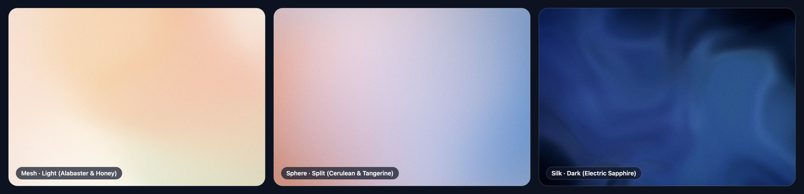
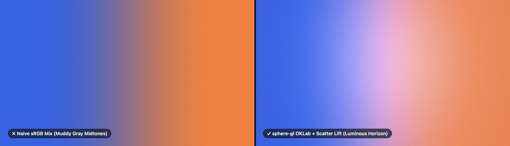

<div align="center">

# sphere-gl

**Fast WebGL2 backgrounds and 5K wallpapers that stay clean in the midtones, match OS light/dark mode, and sleep at `0%` GPU.**

[](https://denissitnikov.github.io/sphere-gl/)
[](https://github.com/denissitnikov/sphere-gl/releases)
[](#)
[](#)
[](./LICENSE)

<br />

<a href="https://denissitnikov.github.io/sphere-gl/">
  
</a>

**[Open Live Studio & 5K Wallpaper Generator →](https://denissitnikov.github.io/sphere-gl/)**

</div>

---

## Why I Built This

I wanted a background for my own website that looked fresh on every visit without shipping a 4 MB PNG or draining laptop batteries with an always-on 60fps shader loop.

When I tried randomizing colors in standard gradients, three things kept breaking:
1. **Muddy midtones:** Blending opposite colors like blue and orange in standard `sRGB` turns the middle into a dull gray-brown.
2. **Broken text contrast:** If a randomizer rolls a bright background behind white text (or a dark background when the user's Mac is in Light Mode), the page becomes unreadable.
3. **Always-on GPU drain:** Most WebGL background scripts run `requestAnimationFrame` forever even when nothing on screen is moving.

So I built `sphere-gl` to fix all three in a single 26 KB file:
* **Clean color mixing (`OKLCH` + `OKLab`):** It picks color chords in `OKLCH` and blends them in `OKLab` with a lightness lift where opposite hues meet, so blue-to-orange transitions pass through bright periwinkle or warm peach instead of mud.
* **Matches OS Light/Dark mode + sets your text color:** By default (`mood="system"`), it checks `prefers-color-scheme` (and `<html class="dark">`) so visitors get a light background in Light Mode and a dark background in Dark Mode. If they toggle their OS appearance, the background smoothly morphs from Day to Night while keeping every sphere in place, and updates `--sphere-ink` and `--sphere-glass` CSS variables (`WCAG >= 4.5:1`).
* **`0%` idle GPU + `Solas Light`:** It draws one Retina frame in ~`0.8 ms` on the GPU and stops. When you move your mouse, `Solas Light` wakes the shader just long enough to tilt a subtle grazing light across the surface, then goes right back to `0%` CPU/GPU when your cursor stops.
* **Live Wallpaper Studio & 8 Irish Atlases:** The [Live Studio](https://denissitnikov.github.io/sphere-gl/) includes 8 curated presets inspired by Irish landscapes (*Burren Chalk*, *Skellig Night*, *Antrim Basalt*, *Boyne Solstice*, *Wicklow Amber*, *Achill Dusk*, *Dingle Horizon*, *Connemara Lough*) and exports directly to `4K`/`5K PNG`, `WebP`, `JPG`, vector `SVG`, or pure `CSS`.



---

## 10-Second Quickstart

Drop 2 lines into any HTML page:

```html
<body data-sphere-bg data-transition-in data-sphere-style="sphere" data-sphere-grain="1.65">
  <h1 style="color: var(--sphere-ink)">A fresh background on every visit.</h1>

  <script src="https://cdn.jsdelivr.net/gh/denissitnikov/sphere-gl@v1.3.0/dist/sphere-gl.min.js" defer></script>
</body>
```

---

## Use With Your Stack

<details open>
<summary><strong>1. CSS Variables (Use an Irish Atlas or Your Own Brand Colors)</strong></summary>

Leave `--sphere-color-*` unset for automatic `OKLCH` palettes on every visit, pick one of the 8 Atlases, or pass 2 to 6 custom hex colors:

```css
#hero {
  --sphere-style: sphere;       /* sphere | mesh | silk | caustic | auto */
  --sphere-atlas: skellig-night; /* optional: burren-chalk, skellig-night, dingle-horizon... */
  --sphere-grain: 1.65;

  /* Or supply your own brand colors:
  --sphere-color-1: #fbf8f0;
  --sphere-color-2: #2563eb;
  --sphere-color-3: #ff7a45;
  --sphere-color-4: #a855f7;
  */

  color: var(--sphere-ink);
}

#hero .card {
  background: var(--sphere-glass);
  border: 1px solid var(--sphere-glass-border);
  backdrop-filter: blur(24px);
}
```
```html
<section id="hero" data-sphere-bg data-transition-in>...</section>
<script src="https://cdn.jsdelivr.net/gh/denissitnikov/sphere-gl@v1.3.0/dist/sphere-gl.min.js" defer></script>
```
</details>

<details>
<summary><strong>2. React / Next.js (`sphere-gl/react`)</strong></summary>

```tsx
import { SphereBackground } from 'sphere-gl/react';

export function Hero() {
  return (
    <SphereBackground
      mode="sphere"        // 'sphere' | 'mesh' | 'silk' | 'caustic' | 'auto'
      mood="system"        // 'system' (matches OS dark/light) | 'any' | 'light' | 'split' | 'dark'
      atlas="dingle-horizon" // optional Irish Atlas preset
      grain={1.65}
      lightFollow={true}   // Solas Light cursor tilt (sleeps at 0% idle when mouse stops)
      motion={false}       // false = 1-shot frame; true = continuous 60fps drift
      style={{ minHeight: '100vh', color: 'var(--sphere-ink)' }}
    >
      <h1>Every visit renders a fresh canvas.</h1>
    </SphereBackground>
  );
}
```

Or copy **any URL from the [Live Studio](https://denissitnikov.github.io/sphere-gl/)** and pass it to `url`:
```tsx
<SphereBackground url="https://denissitnikov.github.io/sphere-gl/#seed=F4L8G2&col=dingle-horizon&style=sphere&grain=1.65" />
```
</details>

<details>
<summary><strong>3. Framer (Code Component)</strong></summary>

In Framer, go to **Assets → Code → Create Code File** and paste this line to get native right-sidebar controls (`Palette`, `Atlas`, `Style`, `Mood`, `Film Grain`, `Solas Light`, `60fps Drift`):

```tsx
export { default } from "https://cdn.jsdelivr.net/gh/denissitnikov/sphere-gl@v1.3.0/dist/sphere-gl.framer.js"
```
</details>

<details>
<summary><strong>4. Vanilla ES Module & Multi-Format Export (`PNG` / `WebP` / `JPG` / `SVG` / `CSS`)</strong></summary>

```js
import { mountSphereBackground } from 'https://cdn.jsdelivr.net/gh/denissitnikov/sphere-gl@v1.3.0/dist/sphere-gl.esm.min.js';

const bg = mountSphereBackground('#hero', {
  style: 'sphere',
  mood: 'system',
  atlas: 'boyne-solstice',
  grain: 1.65,
  onScene(scene) {
    console.log(scene.seed, scene.uiTokens.theme, scene.paletteSwatches);
  },
});

// Roll a new seed with a smooth OKLab morph:
// bg.regenerate({ morph: true });

// Export as PNG, WebP, JPG, SVG, or CSS:
// const webpBlob = await bg.exportImage({ width: 3840, height: 2160, format: 'webp' });
// const svgText  = bg.exportSVG({ width: 1200, height: 630 });
// const cssText  = bg.exportCSS();
```
</details>

---

## HTML Attributes & Auto-Generated CSS Tokens

| Input Attribute | Values | Default | Description |
| :--- | :--- | :--- | :--- |
| `data-sphere-bg` | *(presence)* | | Mounts `<canvas>` (`z-index: -1`) behind all children. |
| `data-transition-in` | *(presence)* | `false` | Smooth `320ms` fade-in on first GPU frame. |
| `data-sphere-style` | `auto` \| `sphere` \| `mesh` \| `silk` \| `caustic` | `auto` | Optical geometry mode. |
| `data-sphere-mood` | `system` \| `any` \| `light` \| `split` \| `dark` | `system` | Matches OS `prefers-color-scheme` and `<html class="dark">` by default. |
| `data-sphere-atlas` | `burren-chalk` \| `skellig-night` \| `antrim-basalt` \| `boyne-solstice` \| `wicklow-amber` \| `achill-dusk` \| `dingle-horizon` \| `connemara-lough` | | Optional curated Irish Atlas. |
| `data-sphere-harmony` | `auto` \| `<archetype-id>` | `auto` | Specific color harmony when not using an Atlas. |
| `data-sphere-grain` | `0` – `2.5` | `1.0` | Film grain (`1.0` = Fine, `1.65` = Editorial, `0` = Off). |
| `data-sphere-light-follow` | `true` \| `false` \| `0.0–1.5` | `true` | `Solas Light` cursor tilt (wakes on mouse move, returns to `0%` idle when still). |
| `data-sphere-motion` | `true` \| `false` | `false` | `false` = `0%` idle static mode; `true` = continuous `60fps` drift. |
| `data-sphere-preset` | `<Studio URL>` | | Reproduces any URL copied from the [Live Studio](https://denissitnikov.github.io/sphere-gl/). |
| `data-sphere-colors` | `#hex1,#hex2,...` | | Custom brand palette (2 to 6 colors). |

**CSS variables set automatically on your container (and `<html>` when mounted on `<body>`):**
`data-sphere-theme="light|dark"` · `--sphere-base` · `--sphere-bloom` · `--sphere-accent` · `--sphere-ink` · `--sphere-ink-muted` · `--sphere-glass` · `--sphere-glass-border`

---

## License

Built by [**Denis S.**](https://github.com/denissitnikov). Released under the [MIT License](./LICENSE).
